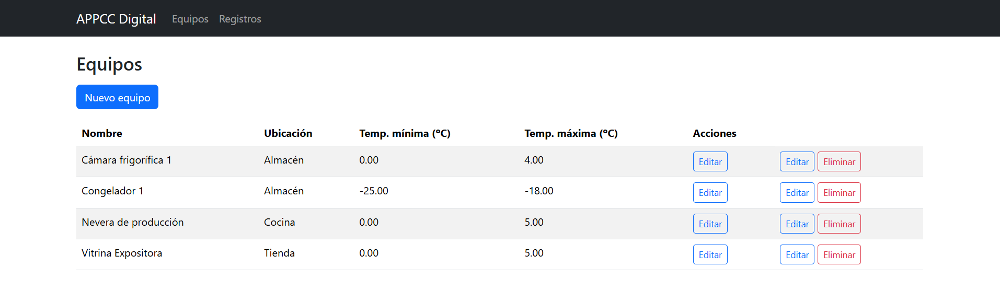
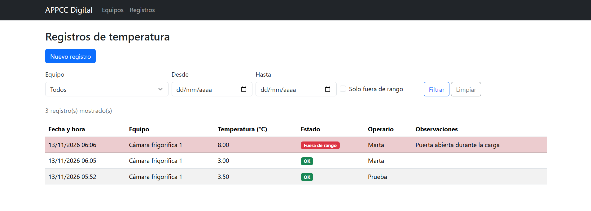
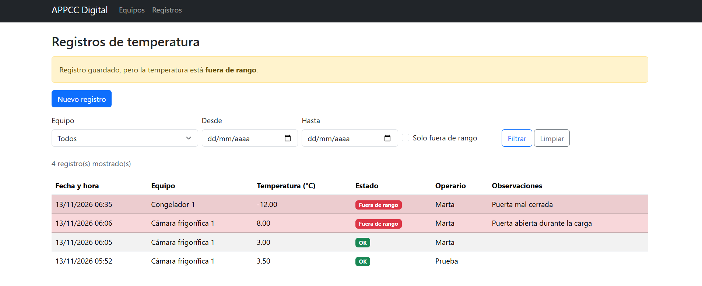
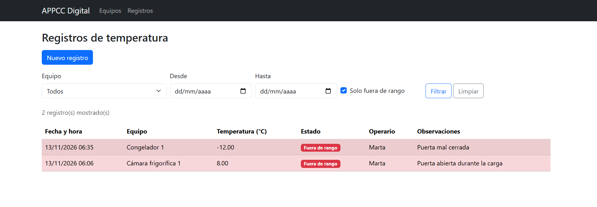

# APPCC Digital

Aplicación web para el **registro digital de temperaturas** de equipos de frío (cámaras, congeladores, neveras) en la industria alimentaria, con **detección automática de valores fuera de rango**, siguiendo la lógica de un sistema APPCC.


## Funcionalidades

- Gestión de equipos (crear, listar, editar y eliminar) con su rango de temperatura permitido.
- Registro de temperaturas por equipo, operario, fecha y hora.
- Detección automática de lecturas fuera de rango, con observación obligatoria en ese caso.
- Listado de registros con filtros por equipo, fechas y "solo fuera de rango".
- Protección del historial: no se puede eliminar un equipo que tenga registros asociados.

## Tecnologías

- PHP 8 (PDO con consultas preparadas)
- MySQL
- HTML, CSS y Bootstrap 5
- Git y GitHub

## Capturas






## Instalación en local

Requisitos: [XAMPP](https://www.apachefriends.org/) (Apache + MySQL/MariaDB + PHP) y Git.

1. Clona el repositorio dentro de la carpeta `htdocs` de XAMPP:
   ```
   git clone https://github.com/martha-br/appcc.git
   ```
2. Arranca **Apache** y **MySQL** desde el panel de XAMPP.
3. En phpMyAdmin (`http://localhost/phpmyadmin`), importa en este orden:
   1. `sql/schema.sql` (crea la base de datos y las tablas)
   2. `sql/datos_ejemplo.sql` (datos de prueba, opcional)
4. Copia `config/db.example.php` como `config/db.php` y ajusta usuario y contraseña. En XAMPP por defecto: usuario `root` y contraseña vacía.
5. Abre `http://localhost/appcc/` en el navegador.

## Estructura del proyecto

```
appcc/
├── config/      Conexión a la base de datos
├── includes/    Cabecera y pie comunes
├── public/      Páginas de la aplicación (equipos y registros)
├── sql/         Esquema y datos de ejemplo
└── docs/img/    Capturas de pantalla
```

## Posibles mejoras

- Guardar el estado "fuera de rango" en el momento del registro, para conservar el histórico aunque cambien los límites.
- Desactivar equipos en lugar de eliminarlos.
- Autenticación de usuarios y roles.
- Exportación de registros a PDF o Excel.

## Autora

[GitHub](https://github.com/martha-br)